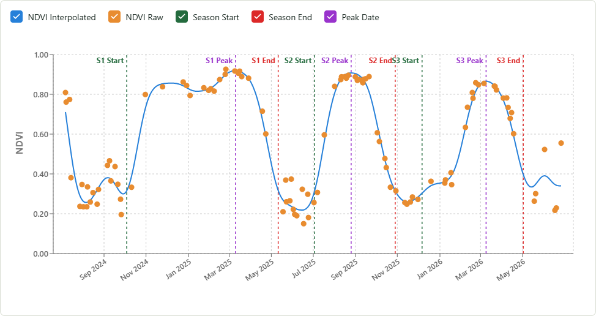

# Crop Cycle Detection

A crop-agnostic model for detecting cropping cycles and extracting seasonal milestones from an NDVI time series — no crop-specific calibration needed.

A hosted version of this model is available at [crop-cycle.growerstech.com](https://crop-cycle.growerstech.com).



## How it works

Most row crops follow a characteristic NDVI trajectory over a growing season: a rise from bare soil through green-up to peak vegetative vigor, followed by senescence and harvest. The shape is consistent enough that a single curve-based model can locate season boundaries, peak timing, and physiological transition points without knowing which crop it is.

The input series can span any length of time — a single season or several years — and the model will detect every complete cropping cycle within it, not just one.

The model takes a DataFrame with ``date`` and ``NDVI`` columns and:

1. Removes cloud-related outliers and downward spikes using locally weighted regression.
2. Resamples to daily frequency and gap-fills with PCHIP interpolation.
3. Smooths the daily series with a Whittaker filter.
4. Detects NDVI peaks and troughs to define trough-to-trough growing seasons.
5. Estimates green-up date, approximate season start/end, and peak NDVI date for each detected season.

## Inputs

``crop_cycle_model(df)`` accepts a DataFrame with at minimum:

| Column | Type | Description |
|--------|------|-------------|
| ``date`` | datetime-like | Observation date (any parseable format, including ISO-8601 with timezone) |
| ``NDVI`` | float | NDVI value (0–1) |

An optional ``poly_name`` column identifies the field; if absent a default name is used.
The function expects data for a **single polygon**. For multiple fields, call it in a loop or in parallel — each call is independent.

## Outputs

Returns a tuple ``(report, ndvi_for_processing)``:

### ``report`` — per-season milestone table

| Column | Description |
|--------|-------------|
| ``season_number`` | Chronological season index |
| ``poly_name`` | Field identifier |
| ``approx_season_start`` | Estimated season start date |
| ``approx_season_end`` | Estimated season end date |
| ``approx_season_length`` | Season length in days |
| ``greenup_date`` | Detected green-up date |
| ``ndvi_peak_date`` | Date of peak NDVI |
| ``ndvi_peak_value`` | Peak NDVI value |
| ``trough_before_peak`` | Date of the pre-season trough |
| ``trough_after_peak`` | Date of the post-season trough |
| ``troughs_days_distance`` | Days between the two bounding troughs |

Empty if no valid seasons are detected.

### ``ndvi_for_processing`` — processed NDVI series

Daily, interpolated, and smoothed NDVI used internally.
Columns: ``date``, ``NDVI``, ``NDVI_interpolated``.

## Installation

Requires Python 3.9+.

```bash
git clone https://github.com/nasaharvest/crop-cycle-detection.git
cd crop-cycle-detection
pip install -r requirements.txt
```

To verify the installation:

```bash
python test_basic.py
```

## Example

```python
import pandas as pd
import sys
sys.path.insert(0, ".")
from src.crop_cycle import crop_cycle_model

df = pd.read_csv("sample_data/example_ndvi.csv", parse_dates=["date"])
report, ndvi_processed = crop_cycle_model(df)
print(report[["season_number", "approx_season_start", "approx_season_end", "ndvi_peak_date"]])
```

A full worked example with visualisation is available in:

- [examples/01_byod.ipynb](examples/01_byod.ipynb) — bring-your-own-data workflow

[](https://colab.research.google.com/github/nasaharvest/crop-cycle-detection/blob/main/examples/01_byod.ipynb)

## Key parameters

All thresholds are configurable via keyword arguments to ``crop_cycle_model``.

| Parameter | Default | Description |
|-----------|---------|-------------|
| ``ndvi_threshold_for_approx_season_start`` | 0.35 | Fallback NDVI level for season start, used if the adaptive threshold (``season_start_pct_of_peak``) never crosses |
| ``ndvi_threshold_for_approx_season_end`` | 0.40 | Fallback NDVI level for season end, used if the adaptive threshold (``season_end_pct_of_peak``) never crosses |
| ``min_season_length`` | 60 | Minimum valid season length in days |
| ``min_ndvi_for_peak`` | None | Hard peak threshold; if None, computed adaptively |
| ``ndvi_peak_percentile`` | 90 | Percentile used for the adaptive peak threshold |
| ``ndvi_peak_threshold_ceiling`` | 0.7 | Upper clip applied to the adaptive peak threshold |
| ``season_start_pct_of_peak`` | 0.35 | Adaptive start threshold (fraction of peak NDVI), tried before the fixed threshold |
| ``season_end_pct_of_peak`` | 0.35 | Adaptive end threshold (fraction of peak NDVI), tried before the fixed threshold |
| ``season_window_days`` | 90 | Search window (days) when no bounding trough exists |
| ``exclude_months`` | None | Exclude detected seasons whose peak NDVI date falls in these months (e.g. to filter out cover-crop or off-season cycles) |

## License

Apache 2.0 — see [LICENSE](LICENSE).

## Citation

If you use this model in your research, please cite:

```bibtex
@software{pelta2026cropcycle,
  author       = {Pelta, Ran},
  title        = {Crop Cycle Detection},
  year         = {2026},
  publisher    = {GitHub},
  organization = {NASA Harvest / Agmatix},
  url          = {https://github.com/nasaharvest/crop-cycle-detection}
}
```

## Authors

Developed by [Ran Pelta](https://www.linkedin.com/in/ran-pelta) (Agmatix / GrowersTech, NASA Harvest)
